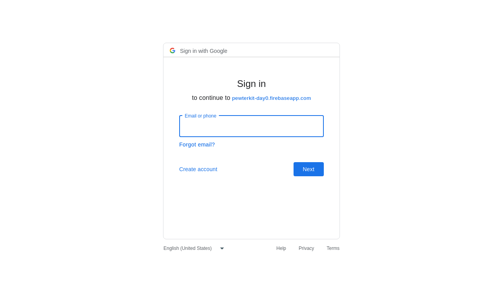
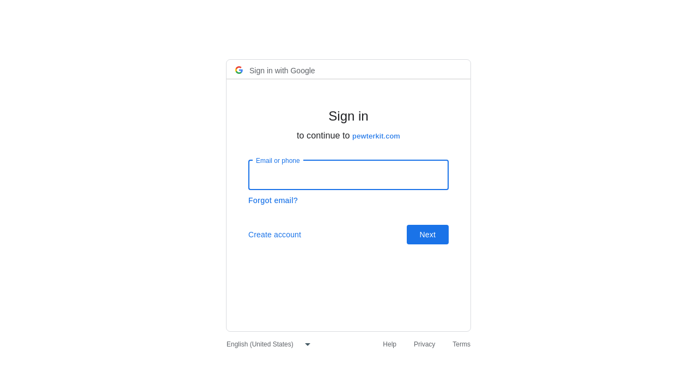

# Lab proof: Google's sign-in screen naming your own domain

This repository holds the raw evidence from one lab test on 24 Oct 2026. It is a test record, not a product page.

## What was tested

A Firebase web app that uses Google sign-in with its default `authDomain` (`<project>.firebaseapp.com`) makes Google's sign-in screen say "to continue to **&lt;project&gt;.firebaseapp.com**" instead of the app's own domain.

The test checked one thing. On an app served from a Cloudflare Worker, does this change make Google's sign-in screen name the app's own domain on the next sign-in?

1. Paste a small snippet into the Worker's `fetch` handler. The snippet forwards `/__/auth/*` to the Firebase project's auth handler.
2. Set `authDomain` to the app's own host.

The snippet, exactly as pasted in every run:

```js
const u = new URL(req.url);
if (u.pathname.startsWith('/__/auth/')) {
  return fetch(new Request(new URL(u.pathname + u.search, 'https://pewterkit-day0.firebaseapp.com'), req));
}
```

The new `authDomain` value was `lab.pewterkit.com`.

## Method

- **Tools:** `ops-lab-timing.mjs`, run as `node ops-lab-timing.mjs 5`, with Playwright 1.48.2 and headless Chromium at 1280×720. No Google account was signed in.
- **The app:** `customer-app.template.js` is a minimal Firebase web app written as a Cloudflare Worker module. It has a literal Firebase config with the default `authDomain` and redirect sign-in.
- **Serving:** the app was served as `https://lab.pewterkit.com` only inside the headless browser, through a Playwright route to the local module. Nothing was deployed and no DNS was changed.
- **Registration:** `lab.pewterkit.com` was already added to the lab project as a Google Cloud OAuth redirect URI (`https://lab.pewterkit.com/__/auth/handler`) and as a Firebase authorised domain.
- **Each run:**
  1. Open the app, click "Sign in with Google (redirect)" and read the domain after "to continue to" on Google's screen.
  2. Fetch the snippet and the `authDomain` value from the fix pack page and paste them into the app source.
  3. Re-import the edited module locally. This stands in for a redeploy; it is not Cloudflare deploy time.
  4. Sign in again and read the domain.
- **Pass rule:** before ends in `firebaseapp.com`, and after equals `pewterkit.com`.
- **Timing:** the clock starts once the wrong screen has been read and stops once the right screen has been read.
- The fix pack URL used in the runs is replaced with `<fix-pack-url>` in timings.json and the script; nothing else in the raw data is changed.

## Results: 5/5 PASS

The runs took place on 24 Oct 2026 between 19:46:06 and 19:46:22 UTC. Raw data is in `timings.json`.

In every run, before = `pewterkit-day0.firebaseapp.com` and after = `pewterkit.com`.

| Run | Before screen load (ms) | Paste snippet (ms) | Set authDomain (ms) | Local reload, not a deploy (ms) | After screen load (ms) | Wrong → right total (ms) |
|---|---|---|---|---|---|---|
| 1 | 1701 | 97 | 0 | 1 | 1639 | 1834 |
| 2 | 1655 | 39 | 0 | 1 | 1334 | 1466 |
| 3 | 1558 | 40 | 0 | 2 | 1242 | 1379 |
| 4 | 1691 | 40 | 0 | 2 | 1203 | 1334 |
| 5 | 1564 | 24 | 0 | 2 | 1209 | 1313 |
| median | 1655 | 40 | 0 | 2 | 1242 | 1379 |
| max | 1701 | 97 | 0 | 2 | 1639 | 1834 |

"Paste snippet" includes fetching the fix pack page. All of these are times taken by a script on a machine. They are not times for a person making the change.

With `authDomain` set to `lab.pewterkit.com`, Google's screen showed `pewterkit.com`, the registrable domain, rather than the full host.

`timings.json` also has a field called `packExpectedMatchesReality: false`. At the time of the test, the "Expected" line on the fix pack page printed the old domain (`pewterkit-day0.firebaseapp.com`) instead of the real result (`pewterkit.com`). That was a wording error on the page. The snippet and the result were not affected.

## Cross-check: 6/6 PASS

These checks ran against the lab app deployed at `https://lab.pewterkit.com` on 24 Oct 2026, from 19:46:22 to 19:46:48 UTC. Raw data is in `lab-crosscheck-proof-results.json`. Each check opened the page, started Google sign-in and read the domain Google named.

| Check | URL | Google named | Result |
|---|---|---|---|
| Supabase, default | https://lab.pewterkit.com/sb | tsojiydjirxcxrqunpih.supabase.co | PASS |
| `/gsi` page, redirect mode | https://lab.pewterkit.com/gsi?mode=redirect | pewterkit.com | PASS |
| Firebase, default authDomain | https://lab.pewterkit.com/fb?ad=default | pewterkit-day0.firebaseapp.com | PASS |
| Firebase, own authDomain + `/__/auth/*` proxy | https://lab.pewterkit.com/fb?ad=self | pewterkit.com | PASS |
| Firebase, static page, default authDomain | https://lab.pewterkit.com/fb-static-default | pewterkit-day0.firebaseapp.com | PASS |
| Firebase, static page, own authDomain + proxy | https://lab.pewterkit.com/fb-static | pewterkit.com | PASS |

The results file names a screenshot for each check. Only the two screenshots below are published here.

## Screenshots

These are unedited PNGs at 1280×720 from headless Chromium, with no Google account signed in.

They were captured in the lab proof run at about 05:11 UTC on 24 Oct 2026 (checks `own-firebase-default` and `own-route1-proxy`). The screenshots from the timing runs above are byte-identical to them.

**Before:** default `authDomain`. Google says "to continue to pewterkit-day0.firebaseapp.com".



**After:** the snippet is in place and `authDomain` is the app's own host. Google says "to continue to pewterkit.com".



Screenshots of Google's sign-in screen captured in our lab on 24 Oct 2026. Google is a trademark of Google LLC; Pewterkit is not affiliated with Google.

## Limits

Proven on Cloudflare Workers, with the domain already added in Google Cloud and Firebase; machine time, not customer time.

The test did not cover:

- Adding the redirect URI in Google Cloud or the authorised domain in Firebase. Both need a person signed in to those consoles, and the lab domain was already registered.
- How long Google takes to apply a newly added redirect URI.
- A real redeploy on Cloudflare. A local module reload stood in for it.
- How long a person, or their AI coding tool, takes to read the steps and make the change.
- DNS or custom-domain set-up.
- Hosts other than Cloudflare Workers.

## Files

| File | What it is |
|---|---|
| `README.md` | This file |
| `proof/hero-before-firebaseapp.png` | Before screenshot (unedited) |
| `proof/hero-after-own-domain.png` | After screenshot (unedited) |
| `timings.json` | Raw output of the 5 timed runs (fix pack URL replaced with `<fix-pack-url>`; otherwise unedited) |
| `lab-crosscheck-proof-results.json` | Raw output of the 6 cross-checks (unedited) |
| `ops-lab-timing.mjs` | The timing script |
| `customer-app.template.js` | The test app fixture |

The only key in these files is the lab Firebase project's public web (browser) API key in `customer-app.template.js`. The lab page serves the same key to every visitor.
